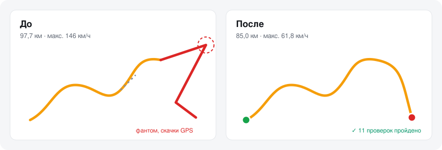
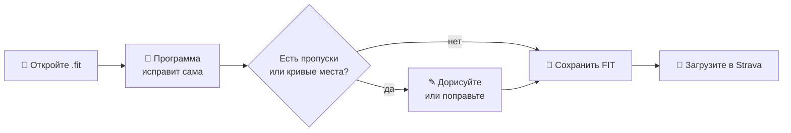

<p align="center">
  
</p>

<h1 align="center">VELO FIX</h1>

<p align="center">
  <b>Исправляет GPS-треки велотренировок, чтобы Strava показывала правду.</b><br>
  Ложные километры, «фантомные» 146 км/ч, скачки GPS, пропуски трека — за пару кликов.
</p>

<p align="center">
  <a href="../../releases/latest"></a>
  
  
  
  <a href="LICENSE"></a>
</p>

<p align="center">
  <a href="../../releases/latest"><b>⬇ Скачать для Windows</b></a> ·
  <a href="#как-пользоваться">Как пользоваться</a> ·
  <a href="#english">English</a>
</p>

<p align="center"></p>

---

## Что исправляет

| Проблема | Как выглядит | Что делает VELO FIX |
|---|---|---|
| 🚀 **Фантомное движение** | Вы стоите, а GPS «едет» 100+ км/ч | Убирает ложные километры, обнуляет скорость, пересчитывает время движения |
| 📏 **Скачки одометра** | +12 км за секунду во время паузы | Заменяет скачок реальной дистанцией по датчику колеса |
| 📍 **GPS-телепортации** | Трек прыгает через кварталы | Удаляет точки, которые дальше, чем вы физически проехали |
| 🕳 **Пропуски GPS** | Трек обрывается в туннеле или в центре | Достраивает по вашему GPX или даёт дорисовать вручную |
| ❤️ **Выбросы пульса и мощности** | Пульс 230 от статики, 3000 Вт на ровном | Сглаживает только явные сбои датчика |
| ♻️ **Дубликаты, разрывы файла** | Заезд разбит на части | Склеивает, обрезает, делит тренировку |

Время, каденс, высота и остальные датчики **не меняются**. Файл остаётся обычным FIT — Strava и Garmin Connect принимают его как родной.

## Возможности

<table>
<tr>
<td width="50%" valign="top">

**🗺 Карта и аналитика**
- Трек по скорости, пульсу или мощности
- Профиль высоты, скорости, пульса, мощности
- Статистика любого отрезка
- Зоны пульса и мощности (FTP, NP, Вт/кг)
- Шторка «Сравнить» — до и после на одной карте

</td>
<td width="50%" valign="top">

**✎ Редактор трека**
- Тянуть линию мышью с домов на дорогу
- Двигать и удалять точки, срезать петли
- Дорисовывать пропуски точками, как в gpx.studio
- Прокладка по дорогам — по ПДД или без (встречка, тротуары)
- Работает **без VPN**: схема улиц (OpenFreeMap) скачивается один раз и прокладка идёт моментально

</td>
</tr>
<tr>
<td valign="top">

**💾 Экспорт**
- FIT для Strava / Garmin
- GPX и TCX для других сервисов
- Отчёт «до и после» в HTML
- PNG-картинка карты
- Готовое описание для Strava
- Картинка «до и после» рядом
- Целая папка FIT за один раз
- Всё одним архивом

</td>
<td valign="top">

**⚙ Удобство**
- Заезды прямо с Garmin / Wahoo по USB
- Незаконченная работа сохраняется сама
- Обновление в одну кнопку
- Русский и английский интерфейс
- Светлая и тёмная тема
- Отмена действий и горячие клавиши (Ctrl+O, Ctrl+S, Ctrl+Z, 1–4)

</td>
</tr>
</table>

## Как пользоваться



1. **Скачайте** архив из [Releases](../../releases/latest), распакуйте, запустите `VELO_FIX.exe`.
2. **Перетащите** в окно `.fit` с велокомпьютера (или нажмите «С велокомпьютера»). Есть GPX маршрута — добавьте и его.
3. **Проверьте** сводку справа: нажмите на исправление — карта покажет место.
4. **Поправьте**, если нужно: «Дорисовать» для пропусков, «✎ Править трек» для кривых участков.
5. **Сохраните FIT** и загрузите в Strava: удалите старую тренировку → «+» → «Загрузить действие» → «Файл».

> **Windows SmartScreen** при первом запуске может предупредить — «Подробнее» → «Выполнить в любом случае». Программа не подписана платным сертификатом.

## Приватность

Файлы обрабатываются **только на вашем компьютере** и никуда не отправляются. В интернет программа ходит лишь за подложкой карты (OpenStreetMap / Esri), схемой улиц OpenFreeMap для прокладки маршрута и проверкой обновлений на GitHub.

## Требования

Windows 10 / 11 (64-бит) и Microsoft Edge или Google Chrome. Права администратора и установка не нужны.

## Сборка из исходников

`src/core.js` — разбор и исправление FIT/GPX · `src/ui.html` — интерфейс · `src/i18n.js` — английский перевод · `windows/main.go` — запускатель · `tests/` — автотесты.

Нужны Python 3, Chrome или Edge (для тестов) и Go 1.21+. Одна команда в PowerShell:

```powershell
.\build.ps1 2.9.0
```

Скрипт прогоняет тесты, проставляет версию во всех файлах, собирает `VELO_FIX.exe` и кладёт в `dist\` архив релиза и файл `.sha256` — загрузите оба в релиз GitHub: автообновление сверяет архив с контрольной суммой.

Только тесты: `python tests/run.py`. Свои заезды для проверки можно положить в `tests/fixtures/*.fit` — в репозиторий они не попадают.

## Проверка загрузки

Рядом с каждым архивом в [Releases](../../releases/latest) лежит `VELO_FIX_<версия>_Windows.zip.sha256`. Сверить вручную:

```powershell
Get-FileHash .\VELO_FIX_2.8.0_Windows.zip -Algorithm SHA256
```

---

## English

**VELO FIX** is a free Windows tool that repairs cycling FIT files so Strava shows what really happened: phantom 100+ km/h “rides” while you stand still, odometer jumps, GPS teleports, GPS gaps, heart-rate and power spikes. It includes a track editor (drag the line, cut loops, draw gaps by hand with road routing), before/after comparison, and exports FIT, GPX, TCX, an HTML report and a ready Strava description. Everything runs locally; the interface is available in English (EN/RU button).

[⬇ Download the latest release](../../releases/latest) — unpack the ZIP and run `VELO_FIX.exe`.

## Лицензия

[MIT](LICENSE) © 2026 Daniil Bogoslovsky
